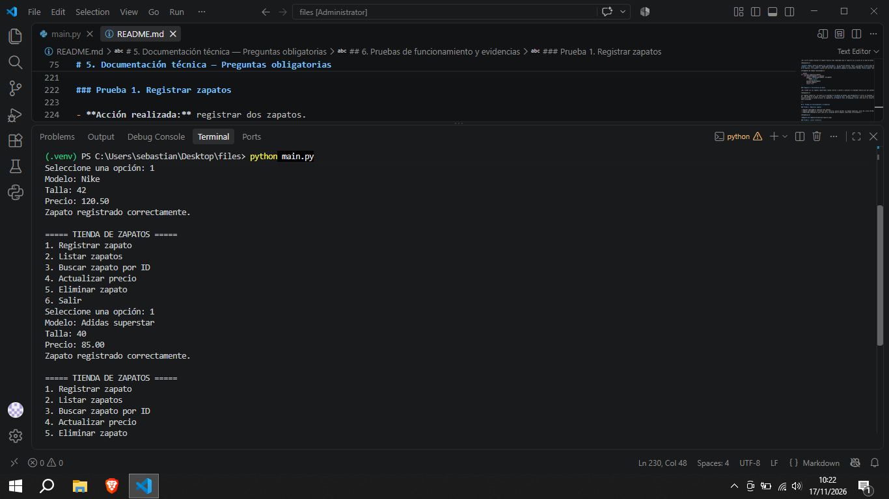
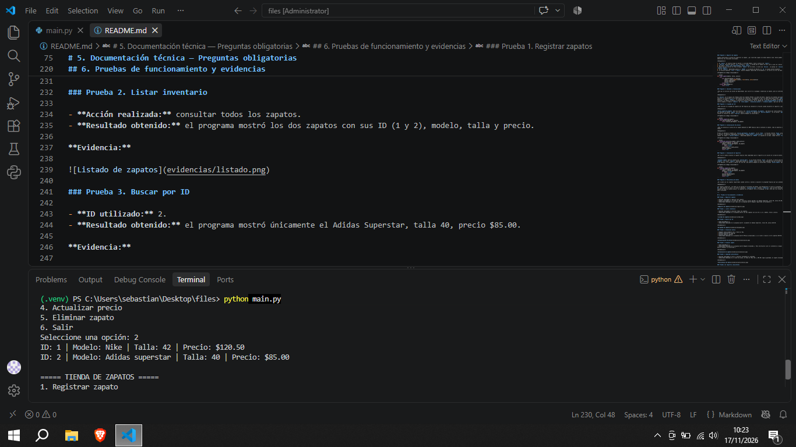
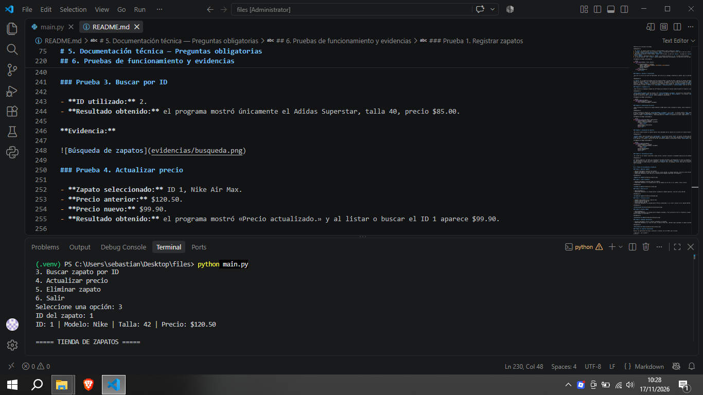
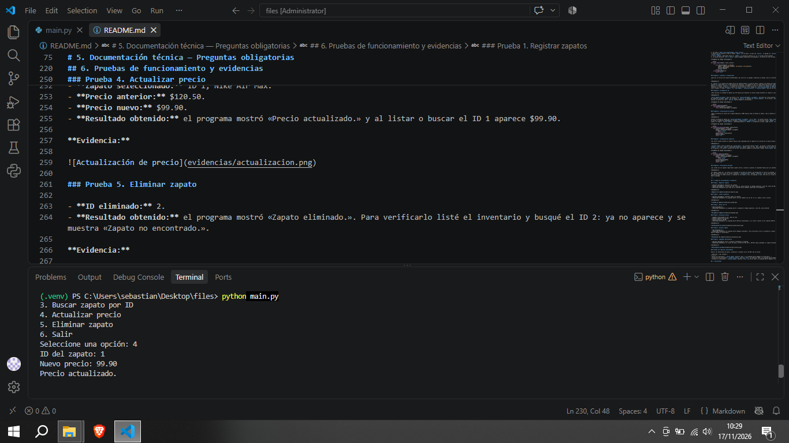
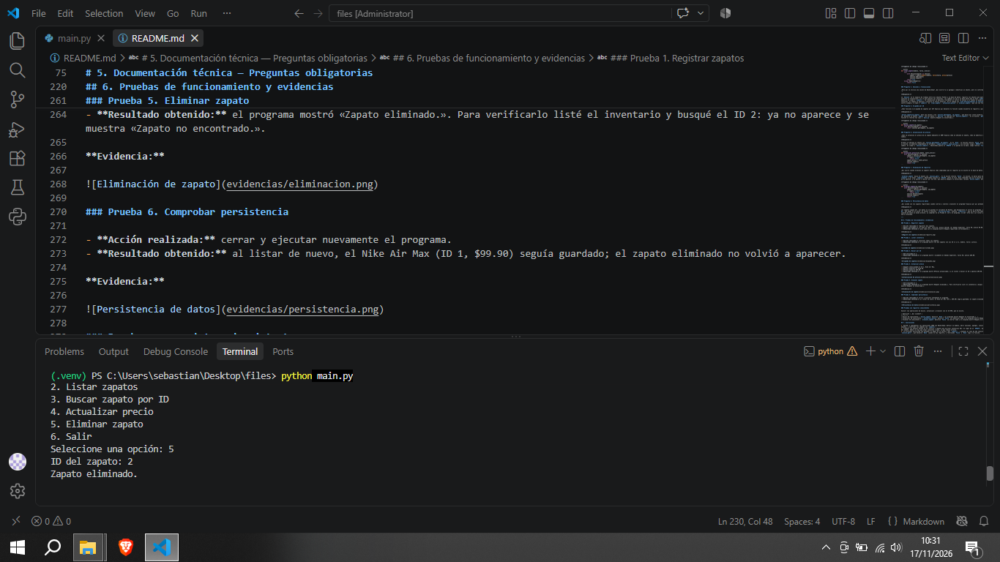
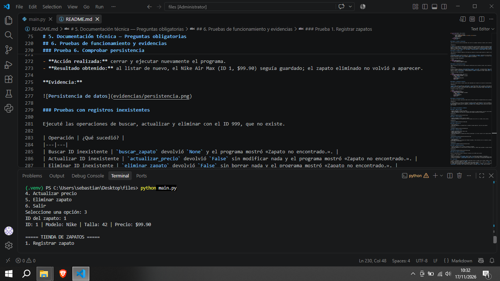

1# Sistema de Inventario de Zapatos — SQLAlchemy ORM

## 1. Información del proyecto

| Información | Descripción |
|---|---|
| Estudiante | Sebastian Andres Mercado Vega |
| Asignatura | Acceso a Datos (4E) |
| Docente | [Nombre del docente] |
| Fecha | 17 de noviembre de 2026 |
| Lenguaje de programación | Python |
| ORM utilizado | SQLAlchemy 2.x |
| Base de datos | SQLite |

## 2. Descripción del proyecto

**¿En qué consiste el programa?**

Es una aplicación de consola para administrar el inventario de una tienda de zapatos. Guarda de cada zapato su modelo, su talla y su precio. El menú (`main.py`) ya venía desarrollado; mi trabajo fue implementar en `datos.py` la capa de persistencia con SQLAlchemy ORM, de modo que la información se guarde en una base SQLite (`zapateria.db`) y no se pierda al cerrar el programa.

**¿Qué funcionalidades tiene?**

- Registrar zapatos.
- Consultar el inventario.
- Buscar zapatos por ID.
- Actualizar precios.
- Eliminar zapatos.

## 3. Estructura del proyecto

```text
tienda_zapatos/
├── main.py
├── datos.py
├── requirements.txt
├── README.md
└── evidencias/
```

**Explicación de los archivos:**

| Archivo | ¿Cuál es su responsabilidad? |
|---|---|
| `main.py` | Muestra el menú, pide los datos al usuario, valida entradas básicas y llama a las funciones de `datos.py`. No contiene código de base de datos. |
| `datos.py` | Capa de persistencia: define el engine, la clase `Base`, el modelo `Zapato` y las funciones CRUD con SQLAlchemy ORM. |
| `requirements.txt` | Lista la dependencia necesaria (`SQLAlchemy>=2.0,<3.0`). |
| `zapateria.db` | Archivo SQLite que se genera automáticamente la primera vez que se ejecuta el programa (al llamar a `inicializar_bd()`), en la carpeta desde donde se ejecuta `main.py`. |

## 4. Instalación y ejecución

**Paso 1. Requisitos**

- Python 3.8 o superior.
- `pip` para instalar dependencias.
- No hace falta instalar SQLite: viene incluido con Python.

**Paso 2. Instalación de dependencias**

```bash
python -m pip install -r requirements.txt
```

**Paso 3. Ejecución**

```bash
python main.py
```

**Paso 4. Resultado esperado**

Aparece el menú «TIENDA DE ZAPATOS» con seis opciones. Se crea el archivo `zapateria.db` en la carpeta del proyecto y el programa queda esperando que se elija una opción. Cada operación muestra un mensaje de confirmación o de error.

---

# 5. Documentación técnica — Preguntas obligatorias

### Pregunta 1. Modelo y tabla

¿Qué clase de Python representa la tabla de la base de datos? Explica cómo SQLAlchemy identifica el nombre de la tabla y sus columnas.

**Respuesta:**

La clase `Zapato` representa la tabla `zapatos`. Hereda de `Base`, que a su vez hereda de `DeclarativeBase`; gracias a eso SQLAlchemy sabe que es un modelo mapeado a una tabla. El nombre de la tabla lo toma del atributo `__tablename__`, y cada columna sale de un atributo anotado con `Mapped[...]` y definido con `mapped_column(...)`. El tipo Python de la anotación (`int`, `str`, `float`) se traduce a un tipo SQL (`INTEGER`, `VARCHAR`, `FLOAT`). Como `id` tiene `primary_key=True`, es la clave primaria y SQLite la autoincrementa. Cada fila de la tabla se convierte en un objeto `Zapato`.

**Fragmento de código relacionado:**

```python
class Base(DeclarativeBase):
    pass

class Zapato(Base):
    __tablename__ = "zapatos"

    id: Mapped[int] = mapped_column(primary_key=True, autoincrement=True)
    modelo: Mapped[str] = mapped_column(String)
    talla: Mapped[int] = mapped_column()
    precio: Mapped[float] = mapped_column(Float)
```

### Pregunta 2. Creación de la base de datos

¿Qué ocurre cuando ejecutas el programa por primera vez? Explica cómo se crea la base de datos `zapateria.db` y la tabla `zapatos`.

**Respuesta:**

Al ejecutar `main.py`, lo primero que hace `main()` es llamar a `datos.inicializar_bd()`. Esa función ejecuta `Base.metadata.create_all(engine)`, que revisa todos los modelos registrados en `Base` (en este caso `Zapato`) y crea las tablas que no existan. Para hacerlo, el engine abre una conexión a `sqlite:///zapateria.db`; como el archivo no existe aún, SQLite lo crea en ese momento. En las siguientes ejecuciones `create_all` detecta que la tabla ya existe y no la vuelve a crear ni borra sus datos.

**Fragmento de código relacionado:**

```python
engine = create_engine("sqlite:///zapateria.db")

def inicializar_bd():
    Base.metadata.create_all(engine)
```

### Pregunta 3. Registro de zapatos

Cuando seleccionas la opción de registrar un zapato, ¿qué recorrido siguen los datos desde el menú hasta quedar almacenados en SQLite? Identifica las funciones utilizadas.

**Respuesta:**

1. En `main()` el usuario elige la opción 1 y escribe modelo, talla y precio con `input()`.
2. `main.py` convierte talla a `int` y precio a `float`, y valida que el modelo no esté vacío y que los números sean positivos.
3. Se llama a `datos.crear_zapato(modelo, talla, precio)`.
4. Dentro de esa función se crea un objeto `Zapato` con los datos, se abre una `Session`, se agrega con `session.add()` y se confirma con `session.commit()`.
5. En el `commit()` SQLAlchemy genera el `INSERT` y lo ejecuta en SQLite; el `id` se asigna automáticamente.
6. La función devuelve `True` y `main()` muestra «Zapato registrado correctamente.». Si ocurre un error de base de datos devuelve `False`.

**Fragmento de código relacionado:**

```python
def crear_zapato(modelo, talla, precio):
    try:
        with Session(engine) as session:
            zapato = Zapato(modelo=modelo, talla=talla, precio=precio)
            session.add(zapato)
            session.commit()
        return True
    except SQLAlchemyError:
        return False
```

### Pregunta 4. Sesiones y transacciones

¿Para qué se utiliza una sesión de SQLAlchemy? ¿Qué ocurriría si agregas o modificas un objeto, pero no confirmas la transacción con `commit()`?

**Respuesta:**

La `Session` es el espacio de trabajo entre mis objetos Python y la base de datos: registra los objetos que agrego, modifico o elimino, controla la transacción y es la que ejecuta las consultas. Los cambios no van a la base hasta que se hace `commit()`. Si agrego o modifico un objeto y no llamo a `commit()`, la transacción se descarta (rollback) al cerrar la sesión y el cambio no queda guardado: al volver a consultar, el zapato no aparece o conserva el precio anterior. En mi código uso `with Session(engine) as session:` para que la sesión se cierre siempre, y llamo a `commit()` en `crear_zapato`, `actualizar_precio` y `eliminar_zapato`, que son las funciones que modifican datos.

### Pregunta 5. Búsqueda por ID

¿Cómo funciona la búsqueda de zapatos por ID? Explica qué devuelve tu función cuando encuentra el registro y qué devuelve cuando no existe.

**Respuesta:**

`buscar_zapato(id_zapato)` abre una sesión y usa `session.get(Zapato, id_zapato)`, que busca por clave primaria. Si existe una fila con ese ID, devuelve un objeto `Zapato` con sus datos, y `main.py` lo imprime con `mostrar_zapato()`. Si no existe, `get()` devuelve `None`, la función lo retorna tal cual y `main.py` muestra «Zapato no encontrado.».

**Fragmento de código relacionado:**

```python
def buscar_zapato(id_zapato):
    with Session(engine) as session:
        return session.get(Zapato, id_zapato)
```

### Pregunta 6. Actualización de precios

¿Cómo se actualiza el precio de un zapato mediante el ORM? Explica cómo se obtiene el objeto, cómo se modifica su atributo y cómo se guarda el cambio.

**Respuesta:**

Primero se obtiene el objeto con `session.get(Zapato, id_zapato)`. Si es `None`, la función retorna `False` porque no hay nada que actualizar. Si existe, se modifica simplemente el atributo (`zapato.precio = nuevo_precio`), sin escribir ningún `UPDATE`: la sesión detecta que el objeto cambió. Al llamar a `session.commit()`, SQLAlchemy genera el `UPDATE` y lo guarda en la base. Luego retorna `True`.

**Fragmento de código relacionado:**

```python
def actualizar_precio(id_zapato, nuevo_precio):
    with Session(engine) as session:
        zapato = session.get(Zapato, id_zapato)
        if zapato is None:
            return False
        zapato.precio = nuevo_precio
        session.commit()
        return True
```

### Pregunta 7. Eliminación de registros

¿Qué ocurre cuando eliminas un zapato? Explica cómo compruebas que el registro ya no existe en la base de datos.

**Respuesta:**

`eliminar_zapato` busca el objeto con `session.get()`. Si no existe retorna `False`. Si existe, lo marca para borrar con `session.delete(zapato)` y al hacer `commit()` SQLAlchemy ejecuta el `DELETE` sobre la fila. Para comprobar que ya no existe uso la opción 2 (listar), donde ya no aparece, y la opción 3 (buscar por ese ID), que muestra «Zapato no encontrado.» porque `buscar_zapato` devuelve `None`.

**Fragmento de código relacionado:**

```python
def eliminar_zapato(id_zapato):
    with Session(engine) as session:
        zapato = session.get(Zapato, id_zapato)
        if zapato is None:
            return False
        session.delete(zapato)
        session.commit()
        return True
```

### Pregunta 8. Persistencia de datos

¿Qué sucede con los zapatos registrados cuando cierras y vuelves a ejecutar el programa? Explica por qué permanecen almacenados.

**Respuesta:**

Los zapatos siguen ahí. Los datos no se guardan en variables de Python, que desaparecen al cerrar el programa, sino en el archivo `zapateria.db`, que queda en el disco. Al volver a ejecutar, `inicializar_bd()` ejecuta `create_all`, que no borra una tabla existente, y el engine se conecta de nuevo al mismo archivo. Lo comprobé en la Prueba 6: cerré el programa, lo abrí otra vez y al listar aparecieron los zapatos que no había eliminado.

---

## 6. Pruebas de funcionamiento y evidencias

### Prueba 1. Registrar zapatos

- **Acción realizada:** registrar dos zapatos.
- **Datos utilizados:** (1) Nike Air Max, talla 42, precio 120.50; (2) Adidas Superstar, talla 40, precio 85.00.
- **Resultado obtenido:** para cada uno el programa mostró «Zapato registrado correctamente.».

**Evidencia:**



### Prueba 2. Listar inventario

- **Acción realizada:** consultar todos los zapatos.
- **Resultado obtenido:** el programa mostró los dos zapatos con sus ID (1 y 2), modelo, talla y precio.

**Evidencia:**



### Prueba 3. Buscar por ID

- **ID utilizado:** 2.
- **Resultado obtenido:** el programa mostró únicamente el Adidas Superstar, talla 40, precio $85.00.

**Evidencia:**



### Prueba 4. Actualizar precio

- **Zapato seleccionado:** ID 1, Nike Air Max.
- **Precio anterior:** $120.50.
- **Precio nuevo:** $99.90.
- **Resultado obtenido:** el programa mostró «Precio actualizado.» y al listar o buscar el ID 1 aparece $99.90.

**Evidencia:**



### Prueba 5. Eliminar zapato

- **ID eliminado:** 2.
- **Resultado obtenido:** el programa mostró «Zapato eliminado.». Para verificarlo listé el inventario y busqué el ID 2: ya no aparece y se muestra «Zapato no encontrado.».

**Evidencia:**



### Prueba 6. Comprobar persistencia

- **Acción realizada:** cerrar y ejecutar nuevamente el programa.
- **Resultado obtenido:** al listar de nuevo, el Nike Air Max (ID 1, $99.90) seguía guardado; el zapato eliminado no volvió a aparecer.

**Evidencia:**



### Pruebas con registros inexistentes

Ejecuté las operaciones de buscar, actualizar y eliminar con el ID 999, que no existe.

| Operación | ¿Qué sucedió? |
|---|---|
| Buscar ID inexistente | `buscar_zapato` devolvió `None` y el programa mostró «Zapato no encontrado.». |
| Actualizar ID inexistente | `actualizar_precio` devolvió `False` sin modificar nada y el programa mostró «Zapato no encontrado.». |
| Eliminar ID inexistente | `eliminar_zapato` devolvió `False` sin borrar nada y el programa mostró «Zapato no encontrado.». |

## 7. Conclusiones

1. Aprendí a implementar las operaciones CRUD con SQLAlchemy: definir un modelo, abrir sesiones, agregar, consultar, modificar y eliminar objetos, y confirmar los cambios con `commit()`.
2. Trabajar con objetos Python es más natural y legible que escribir sentencias SQL: en lugar de un `UPDATE`, basta con cambiar un atributo del objeto. Además no hay que armar consultas a mano, lo que reduce errores.
3. La principal dificultad fue entender el papel de la sesión y del `commit()`, y manejar el caso de IDs inexistentes. Lo resolví usando `session.get()`, que devuelve `None` cuando no hay registro, y retornando `False` o `None` según la función.
